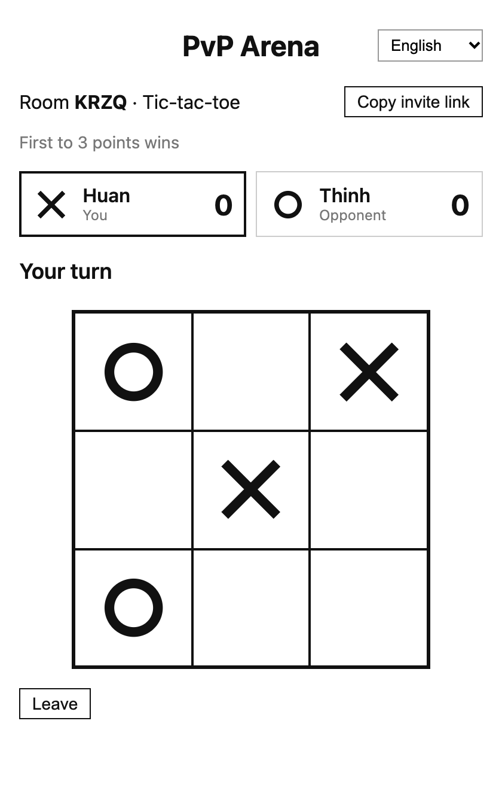

# PvP Arena

<<<<<<< HEAD
Chơi game đối kháng online với bạn bè ngay trên trình duyệt.
=======
Play head-to-head games with a friend, right in the browser.
>>>>>>> 75e64e2 (Add Rock Paper Scissors and Load-Shield-Shoot, hand reveal animations, target score, i18n (vi/en/ja/ko/zh), English README)

<p>
  
  
  
  
</p>

## Games

| Game | Players | How to win |
|---|---|---|
| Tic-tac-toe | 2 | Take turns. Get three in a row. |
| Rock Paper Scissors | 2 | Both pick at the same time. Rock beats scissors, scissors beat paper, paper beats rock. |
| Load, Shield, Shoot | 2 | Both pick at the same time each turn. Load adds a bullet. Shield blocks every shot. Shoot spends a bullet and hits if your opponent is loading. Two shots cancel out. Whoever gets hit loses the round. |

When you create a room you choose how many points win the match.
Rock Paper Scissors also lets you show or hide the move history.

Hand games play a short "one, two, three" shake before both hands are revealed, just like playing in person.

The interface is available in English, Vietnamese, Japanese, Korean and Chinese.

## Install

You need [Node.js](https://nodejs.org) 18 or newer.

```bash
git clone https://github.com/LionelHuanSi/PvP_Arena.git
cd PvP_Arena
npm install
```

To let friends on other networks join, install Cloudflare Tunnel once:

```bash
brew install cloudflared                 # macOS
winget install Cloudflare.cloudflared    # Windows
```

## Play

**1. Start the server** (only the host does this):

```bash
npm start
```

**2. In a second terminal, create a public link:**

```bash
cloudflared tunnel --url http://localhost:3000
```

It prints a link like `https://something.trycloudflare.com`.

**3. Play:**

1. Open the link, enter your name, pick a game and the target score, then click **Create room**.
2. Click **Copy invite link** and send it to your friend.
3. Your friend opens the link, enters a name and clicks **Join room**.

After a match ends, click **New match** to play again.

## Tips

- Keep both terminals open while you play.
- The tunnel link changes every time you restart `cloudflared`. Send your friend the new one.
- On the same Wi-Fi you can skip the tunnel and open `http://<your-computer-ip>:3000`.
