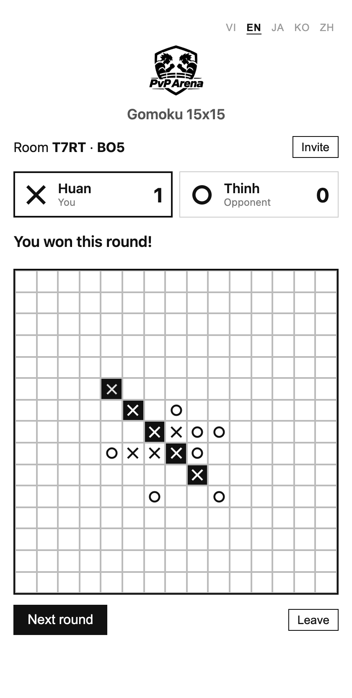
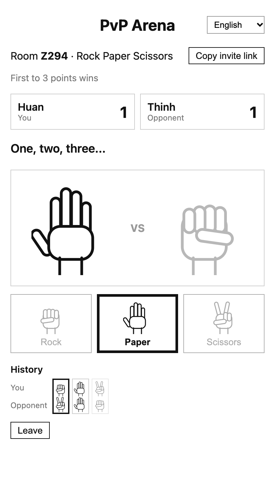
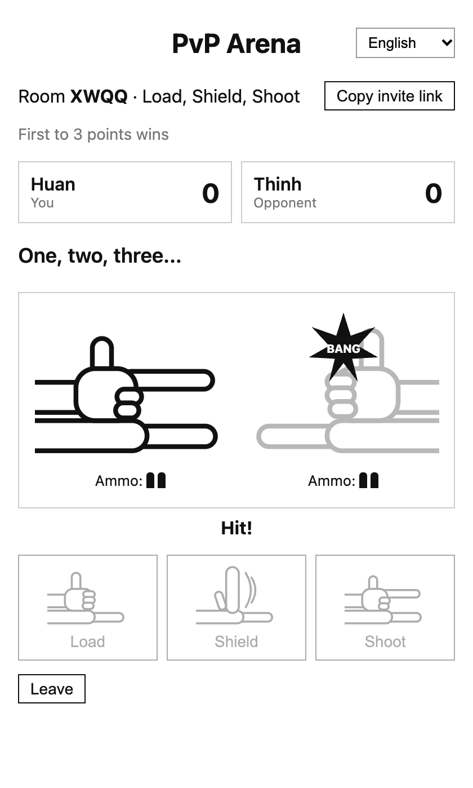
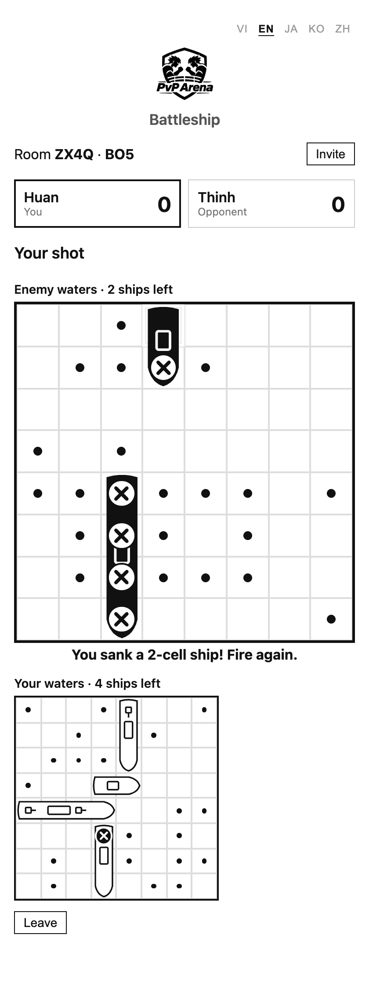

<p align="center"></p>

<h1 align="center">PvP Arena</h1>

Play head-to-head games with a friend, right in the browser.

<p>
  
  
  
</p>
<p>
  
  
  
</p>

## Games

| Game | Players | How to win |
|---|---|---|
| Tic-tac-toe | 2 | Take turns. Get three in a row. |
| Gomoku 15x15 | 2 | Take turns on a 15x15 board. Get five in a row. Optional rule: a five blocked at both ends does not count. |
| Rock Paper Scissors | 2 | Both pick at the same time. Rock beats scissors, scissors beat paper, paper beats rock. |
| Load, Shield, Shoot | 2 | Both pick at the same time each turn. Load adds a bullet. Shield blocks normal shots. Shoot spends a bullet and hits if your opponent is loading. With 5 bullets you can fire a Kamehameha, which no shield can stop. Whoever gets hit loses the round. If both players shoot, or both fire a Kamehameha, the round is a draw. |
| Battleship | 2 | Place four ships in secret on an 8x8 sea, then take turns firing. A hit lets you fire again, a miss passes the turn. Sink all enemy ships first to win. |

When you create a room you pick the match format, such as BO3 or BO5. In a BO5 the first player to win 3 rounds takes the match.
Rock Paper Scissors also lets you show or hide the move history.

Hand games play a short "one, two, three" shake before both hands are revealed, just like playing in person.

The interface is available in English, Vietnamese, Japanese, Korean and Chinese.

## Install

You need [Node.js](https://nodejs.org) 18 or newer.

```bash
git clone https://github.com/LionelHuanSi/PvP_Arena.git
cd PvP_Arena
npm install
```

To let friends on other networks join, install Cloudflare Tunnel once:

```bash
brew install cloudflared                 # macOS
winget install Cloudflare.cloudflared    # Windows
```

## Play

**1. Start the server** (only the host does this):

```bash
npm start
```

**2. In a second terminal, create a public link:**

```bash
cloudflared tunnel --url http://localhost:3000
```

It prints a link like `https://something.trycloudflare.com`.

**3. Play:**

1. Open the link, enter your name, pick a game and the format (BO3, BO5...), then click **Create room**.
2. Click **Invite** and send the link to your friend.
3. Your friend opens the link, enters a name and clicks **Join room**.

On a phone, the **Invite** button opens the share sheet so you can send the link straight through Messenger, Zalo or any chat app.

After a match ends, click **New match** to play again.

## Tips

- Keep both terminals open while you play.
- The tunnel link changes every time you restart `cloudflared`. Send your friend the new one.
- On the same Wi-Fi you can skip the tunnel and open `http://<your-computer-ip>:3000`.
