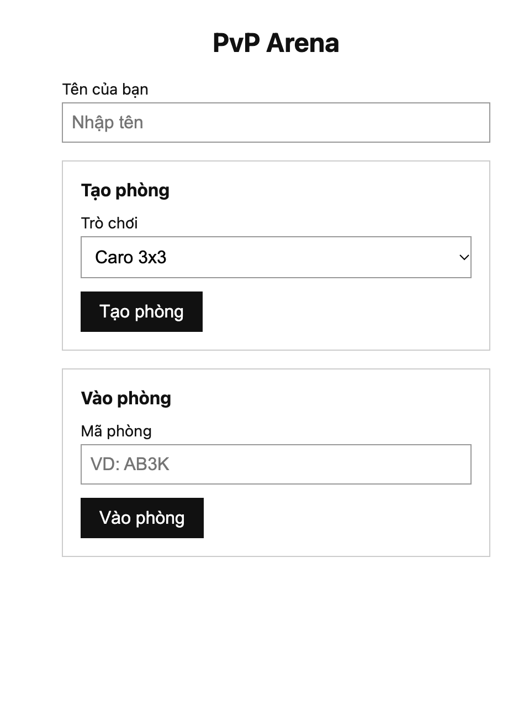
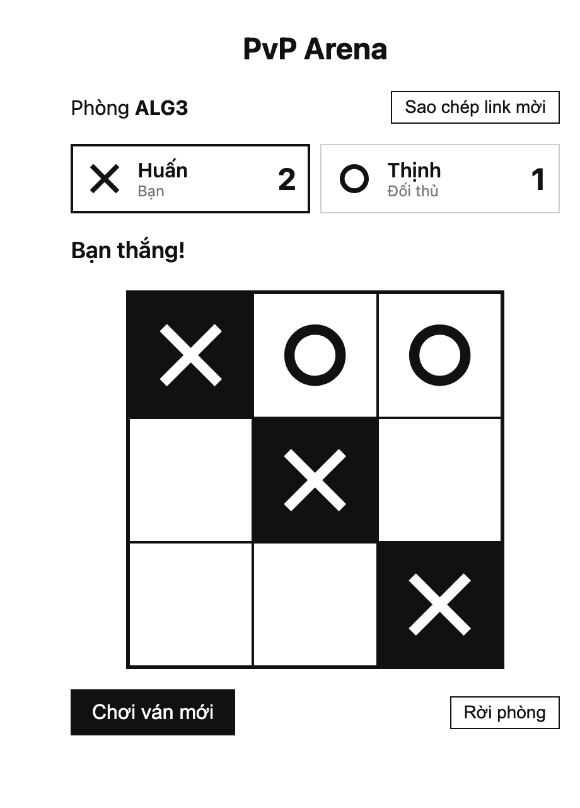

# PvP Arena

Chơi game đối kháng online với bạn bè ngay trên trình duyệt.
Hai người ở hai nơi khác nhau, khác wifi vẫn chơi được.

<p>
  
  
</p>

## Các trò chơi

| Trò | Số người | Luật |
|---|---|---|
| Caro 3x3 | 2 | Ai xếp được 3 quân thẳng hàng trước thì thắng |

Sẽ thêm: Caro 15x15, Connect 4, Bắn tàu, Cờ vua...

## Cài đặt

Cần có [Node.js](https://nodejs.org) (bản 18 trở lên).

```bash
git clone https://github.com/LionelHuanSi/PvP_Arena.git
cd PvP_Arena
npm install
```

Cài thêm Cloudflare Tunnel để bạn bè ở xa vào được (chỉ cần làm một lần):

```bash
brew install cloudflared        # macOS
winget install Cloudflare.cloudflared   # Windows
```

## Cách chơi

**1. Chạy game** (người làm chủ phòng làm bước này):

```bash
npm start
```

**2. Mở một terminal khác và tạo link công khai:**

```bash
cloudflared tunnel --url http://localhost:3000
```

Terminal sẽ in ra một link dạng `https://xxx.trycloudflare.com`.

**3. Vào chơi:**

1. Mở link vừa có, nhập tên, chọn trò rồi bấm **Tạo phòng**.
2. Bấm **Sao chép link mời** và gửi cho bạn của bạn.
3. Bạn của bạn mở link, nhập tên rồi bấm **Vào phòng**.

Sau mỗi ván, bấm **Chơi ván mới** để đấu tiếp. Người đi trước sẽ đổi luân phiên, tỉ số được giữ lại.

## Lưu ý

- Giữ cả hai cửa sổ terminal mở trong lúc chơi.
- Mỗi lần chạy lại `cloudflared`, link sẽ đổi. Nhớ gửi link mới cho bạn.
- Nếu chỉ chơi trong cùng wifi, có thể bỏ qua bước 2 và mở `http://<IP-máy-bạn>:3000`.
